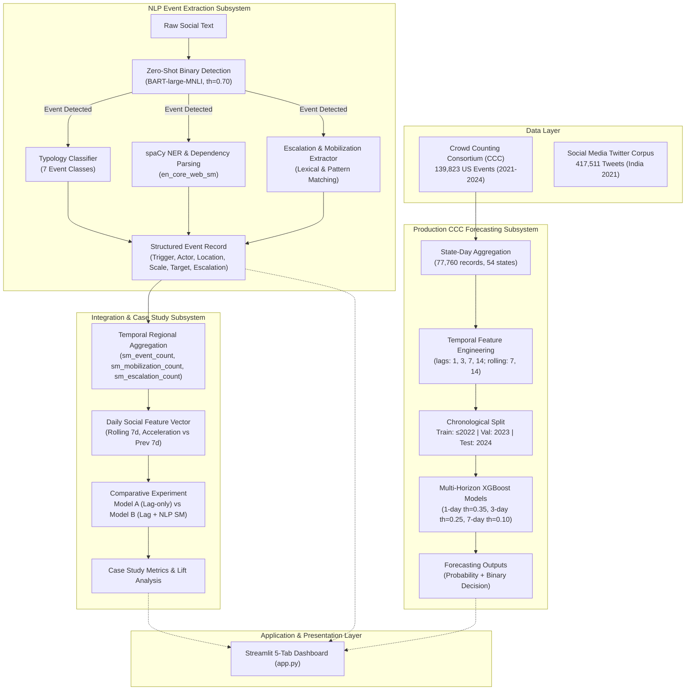

# System Architecture & Technical Specifications

**Project Title:** AI-Powered Civil Unrest Event Extraction & Short-Term Forecasting  
**Repository:** `civil-unrest-detection-and-forecasting`  
**Target Platform:** Python 3.13 / macOS (MPS Accelerator) / Streamlit  

---

## 1. High-Level Architecture Overview

The system architecture is structured into **two decoupled subsystems** and a **bridge layer**:
1. **Production Time-Series Forecasting Subsystem (US CCC Corpus):** Processes historical event counts from the Crowd Counting Consortium (2021–2024), computes backward-looking temporal lag and rolling features, and generates 1-day, 3-day, and 7-day civil unrest forecasts using trained Gradient Boosted Decision Trees (XGBoost).
2. **NLP Social Media Event Extraction Subsystem (Twitter Corpus):** Ingests raw, unstructured social media text, performs zero-shot unrest detection and event categorization, extracts key event arguments (actors, targets, scale, locations, dates), and flags escalation indicators and mobilization calls.
3. **Multimodal Feature Bridge & Case Study Subsystem (India Farmers' Protest):** Demonstrates how NLP extraction outputs can be temporally aggregated into continuous daily feature vectors and fed into predictive models to forecast unrest activity spikes.

---

## 2. Component Specifications

### 2.1 Data Processing (`backend/data_processing.py`)
- **Input:** `data/ccc_compiled_20212024.csv` (113 MB Latin-1 CSV).
- **Core Function:** `load_and_process_data()`
  - Fills full Cartesian product of `(state, date)` to ensure unbroken timelines.
  - Aggregates event occurrences to daily counts (`event_count`).
  - Computes non-leaking lag features: `lag_1`, `lag_3`, `lag_7`, `lag_14`.
  - Computes backward-looking rolling statistics: `rolling_7_mean`, `rolling_7_sum`, `rolling_14_mean`.
  - Generates forward-shifted binary targets: `target_1day` ($t+1$), `target_3day` ($t+1 \dots t+3$), `target_7day` ($t+1 \dots t+7$).

### 2.2 NLP Event Extraction (`backend/social_media_extraction.py`)
- **Core Models:**
  - `facebook/bart-large-mnli` for zero-shot hypothesis testing (`device="mps"` or `"cuda"` / `"cpu"`).
  - `en_core_web_sm` for tokenization, dependency parsing, and NER.
- **Core Function:** `extract_event(text, threshold=0.70)`
  - **Stage 1 (Detection):** Tests hypothesis `"This text is text reporting civil unrest or a protest event"`.
  - **Stage 2 (Typology):** Categorizes across `protest`, `demonstration`, `strike`, `riot`, `labor dispute`, `political unrest`, `other`.
  - **Stage 3 (Arguments):**
    - Triggers: Root verbs and head nouns matching protest action lemmas.
    - Actors: Subjects, agents, and `PERSON`/`ORG` entities.
    - Locations: `GPE` and `LOC` spans.
    - Targets: Prepositional objects following `against`, `demanding`, `over`, `opposing`.
    - Scale: `CARDINAL` quantities modifying crowd keywords (*thousands*, *50,000*).
    - Escalation: Detection of violence, teargas, lathi charge, barricades, roadblocks, and clashes.
    - Mobilization: Solicitation patterns (*join us*, *march to*, *rally at*, *chalo*).

### 2.3 Social Media Feature Generation (`backend/social_media_features.py`)
- **Core Function:** `compute_social_features(extractions_df)`
  - Aggregates post-level extraction records into daily time-series features:
    - `sm_event_count`: Total daily civil unrest events.
    - `sm_mobilization_count`: Daily call-to-action volume.
    - `sm_escalation_count`: Daily reports with tactical escalation.
    - `sm_protest_count`, `sm_strike_count`, `sm_clash_count`: Typology-specific frequencies.
    - `sm_actor_diversity`: Count of unique organizing groups.
    - `sm_rolling_7_mean`, `sm_rolling_7_sum`: 7-day smoothing.
    - `sm_delta_vs_prev7`: Activity acceleration relative to prior week.

### 2.4 Integration Pipeline (`backend/integration_pipeline.py`)
- **Class:** `IntegrationPipeline`
  - Encapsulates end-to-end ingestion from raw post strings to daily feature vectors.
  - Implements `run_extraction()`, `get_features_for_date()`, and `run_demo()`.

### 2.5 Comparative Case Study Engine (`backend/case_study.py`)
- **Function:** `run_case_study(extractions_df)`
  - Trains Model A (Lag-only) and Model B (Lag + NLP Social Signals) across 58 days of continuous data.
  - Chronological split: 65% train, 35% test.
  - Computes Accuracy, Precision, Recall, F1, PR-AUC, and Confusion Matrices.

### 2.6 Multi-Horizon Forecasting Engine (`backend/predict.py`)
- **Artifacts:** `models/xgboost_1day.json`, `models/xgboost_3day.json`, `models/xgboost_7day.json`.
- **Operating Thresholds:** 1-day (0.35), 3-day (0.25), 7-day (0.10).
- **Core Function:** `predict_unrest(features_dict, horizon_days=1)`

### 2.7 Interactive Dashboard (`app.py`)
- Built with Streamlit wide-layout styling.
- 5 Functional Tabs:
  1. *NLP Event Extraction:* Interactive text field and batch demo runner.
  2. *Temporal Event Browser:* Interactive timeline charts and event distributions.
  3. *CCC Forecasting (Baseline):* Historical state lookups and live XGBoost predictions.
  4. *Integration Case Study:* Side-by-side comparative results and methodological disclosures.
  5. *Model Evaluation & Metrics:* Full PR-AUC, F1, precision, recall, and confusion matrix displays.
