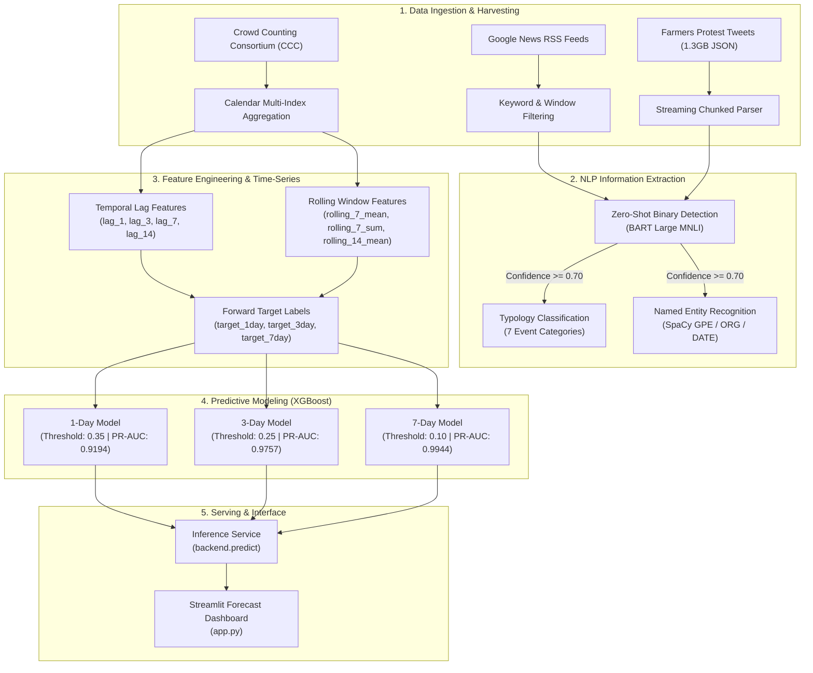

# Civil Unrest Event Extraction & Prediction from Social Media Data

A dual-tier machine learning system for extracting civil unrest events from unstructured text and forecasting multi-horizon protest activity using state-level temporal dynamics.

---

## 1. System Overview

This project comprises two distinct, complementary machine learning subsystems designed to study civil unrest:

1. **Unstructured NLP Extraction Pipeline**: Extracts unrest mentions, classifies 7 event categories (*protest, demonstration, strike, riot, labor dispute, political unrest, other*), and extracts named entities (locations, organizations, dates) from streaming tweets, social posts, and news RSS feeds using zero-shot classification (BART Large MNLI) and SpaCy NER.
2. **Structured Time-Series Forecasting Pipeline**: Aggregates event observations into daily state-level counts across all 50 US states and DC from the Crowd Counting Consortium (CCC) dataset (2021–2024), constructs historical lag and rolling statistical features, and forecasts positive unrest incidence across **1-day**, **3-day**, and **7-day** future horizons using calibrated XGBoost classifiers.
3. **Interactive Dashboard**: A modern Streamlit application providing region-based historical exploration, feature visualization, multi-horizon probabilistic risk gauges, and ground-truth validation.

> [!NOTE]
> **Subsystem Relationship**: The NLP event extraction and time-series forecasting pipelines are distinct, modular components. The NLP pipeline processes unstructured text (e.g., Google News RSS feeds, Farmers' protest tweets), while the predictive models are trained on structured historical event registries (Crowd Counting Consortium). They are evaluated independently and are not connected as a single end-to-end streaming feedback loop.



---

## 2. Benchmark Performance

The models were evaluated on the held-out **2024 calendar year** (19,386 state-day observations across all 50 states + DC), strictly separated from training (2021–2022) and validation (2023):

| Horizon | Calibrated Threshold | PR-AUC | F1-Score | Precision | Recall | Accuracy |
| :--- | :--- | :--- | :--- | :--- | :--- | :--- |
| **1-Day Horizon** | 0.35 | **0.9194** | 0.8398 | 0.8144 | 0.8670 | 80.60% |
| **3-Day Horizon** | 0.25 | **0.9757** | 0.9161 | 0.8838 | 0.9509 | 86.45% |
| **7-Day Horizon** | 0.10 | **0.9944** | 0.9681 | 0.9502 | 0.9868 | 94.15% |

### Baseline Comparison
Compared to the JHU-CUT Twitter benchmark (*Alexandra DeLucia et al., EMNLP 2020 W-NUT*) which evaluated tweet-level classification (BERTweet F1: 0.814, Keyword Count F1: 0.782), this architecture extends beyond single-text classification into multi-horizon geographic activity forecasting with high recall (86.7% to 98.7%).

---

## 3. Project Structure

```
civil-unrest-forecasting/
├── app.py                         # 5-tab interactive Streamlit forecast dashboard
├── requirements.txt               # Locked project dependencies
├── Makefile                       # Developer task automation
├── pytest.ini                     # Pytest configuration and testpaths
├── pyproject.toml                 # Project packaging configuration
│
├── PROJECT_AUDIT.md               # Requirement-to-implementation trace matrix
├── ARCHITECTURE.md                # System specifications and architectural diagram
├── DATASET_DOCUMENTATION.md       # Corpus provenance, stats, and class distributions
├── RESULTS.md                     # Comprehensive multi-horizon and case study benchmarks
├── FACULTY_DEMO_GUIDE.md          # 8-10 minute presentation guide and oral defense script
├── TWO_PAGE_PROGRESS_REPORT.md    # 2-page concise progress summary for faculty
├── VERIFICATION_REPORT.md         # Independent verification audit report
│
├── backend/                       # Core Python application package
│   ├── __init__.py
│   ├── data_processing.py         # CCC calendar multi-indexing & feature engineering
│   ├── predict.py                 # Multi-horizon XGBoost inference engine
│   ├── train.py                   # Standalone reproducible XGBoost training pipeline
│   ├── evaluation.py              # Metric calculation (PR-AUC, F1, Precision, Recall)
│   ├── evaluate_dataset.py        # 2024 test evaluation runner
│   ├── social_media_extraction.py # NLP zero-shot classification, argument parsing & escalation
│   ├── social_media_features.py   # Daily social feature aggregation & temporal rolling
│   ├── integration_pipeline.py    # End-to-end multimodal demo ingestion pipeline
│   ├── case_study.py              # Comparative experiment: Lag-only vs Lag+NLP features
│   ├── nlp_evaluation.py          # Benchmark evaluator against human annotations
│   ├── collect_protests.py        # Google News RSS harvester
│   ├── clean_protest_data.py      # Keyword & relevance filtering
│   ├── filter_event_periods.py    # Temporal window filtering
│   ├── analyze_protest_timeline.py# Protest temporal analysis
│   ├── process_farmers_tweets.py  # Streaming 10k-chunk JSON tweet parser
│   └── clean_farmers_tweets.py    # Tweet normalization & deduplication
│
├── docs/                          # Methodology & guidelines
│   └── ANNOTATION_GUIDELINES.md   # Explicit human annotation criteria & schema
│
├── models/                        # Persisted model binaries & metadata
│   ├── metadata.json              # Features, calibrated thresholds, and hyperparameters
│   ├── xgboost_1day.json          # 1-day forecast model (threshold: 0.35)
│   ├── xgboost_3day.json          # 3-day forecast model (threshold: 0.25)
│   └── xgboost_7day.json          # 7-day forecast model (threshold: 0.10)
│
├── data/                          # Curated sample data & benchmarks
│   ├── README.md                  # Dataset schemas and acquisition guide
│   ├── demo_social_posts.csv      # 10 sample posts for pipeline smoke tests
│   ├── annotation_benchmark.csv   # 200 stratified tweets with human/model annotation fields
│   ├── protest_articles.csv       # Harvested protest news headlines
│   ├── cleaned_protest_articles.csv # Cleaned protest articles
│   └── final_protest_articles.csv # Window-filtered protest articles
│
├── results/                       # Benchmark metrics & case study extractions
│   ├── README.md                  # Result catalog and evaluation documentation
│   ├── final_results.csv          # 2024 test metrics across horizons
│   ├── case_study_results.json    # India Farmers' Protest comparative experiment metrics
│   ├── benchmark_model_predictions.csv # NLP predictions across 200 benchmark posts
│   ├── farmers_protest_sample_extractions.csv # 870 structured extractions across 58 days
│   ├── demo_extracted_events.csv  # Extraction outputs for demo posts
│   └── final_protest_extractions.csv # Extraction outputs for protest articles
│
└── tests/                         # Automated test suite (47 unit & integration tests)
    ├── test_data_processing.py    # Feature calculation, lag math, and leakage tests
    ├── test_predict.py            # Model loading, boundary, and batch inference tests
    ├── test_train.py              # Split logic and dry-run training tests
    ├── test_evaluation.py         # Classification metrics and zero-division tests
    ├── test_nlp.py                # NLP argument extraction, escalation, and sanitization tests
    ├── test_integration.py        # Social media features and case study pipeline tests
    └── test_dashboard.py          # Streamlit 5-tab compilation and execution flow tests
```

---

## 4. Quickstart Guide

### Prerequisites
* Python 3.10+ (tested on Python 3.13 macOS)
* Apple Silicon GPU (MPS), NVIDIA CUDA, or CPU

### Installation
Clone the repository and install dependencies:

```bash
# Clone repository
git clone https://github.com/Pranjal099/civil-unrest-detection-and-forecasting.git
cd civil-unrest-detection-and-forecasting

# Install dependencies and download SpaCy language model
pip install -r requirements.txt
python -m spacy download en_core_web_sm
```

---

## 5. Running the Test Suite

The project includes an extensive test suite (**47 passing automated tests**) covering temporal feature calculations, no-lookahead leakage guarantees, model inference, training dry-runs, NLP argument extraction, and multimodal integration:

```bash
# Run complete test suite (all 47 tests pass in ~12 seconds)
PYTHONPATH=. pytest tests/ -v
```

---

## 6. Launching the 5-Tab Faculty Demonstration Dashboard

Launch the interactive Streamlit application to explore event extractions, historical state predictions, and comparative case studies:

```bash
streamlit run app.py
```

The application provides five distinct tabs:
1. **🔍 NLP Event Extraction:** Interactive text field and batch demo runner extracting triggers, actors, targets, scale, and escalation indicators from social text.
2. **📅 Temporal Event Browser:** Visualizes daily tweet volume, event typologies, and escalation frequency across the 58-day Farmers' Protest dataset.
3. **📈 CCC Forecasting (Baseline):** State-level historical lookups across 54 US states and live multi-horizon (1d, 3d, 7d) XGBoost predictions validated against ground truth.
4. **🔗 Integration Case Study:** Side-by-side comparative evaluation of Model A (Lag-only) vs Model B (Multimodal Integrated) on a continuous protest timeline.
5. **📊 Model Evaluation & Metrics:** Comprehensive PR-AUC, F1, precision, recall, and confusion matrix displays across all three horizons.

---

## 7. Four-Member Team Contribution Plan

This project is architected for collaborative academic development across four distinct specializations:

| Member Role | Primary Responsibilities | Key Deliverables & Code Modules |
|---|---|---|
| **Member 1: Lead NLP Engineer** | Zero-shot unrest detection, event typology classification, spaCy argument parsing (actors, triggers, targets, crowd scale), and lexical escalation detection. | `backend/social_media_extraction.py`, `tests/test_nlp.py` |
| **Member 2: Data Annotation & Evaluation Lead** | Stratified sampling of 200 benchmark posts, authoring annotation guidelines, gold standard verification, and benchmark evaluation scripts. | `data/annotation_benchmark.csv`, `docs/ANNOTATION_GUIDELINES.md`, `backend/nlp_evaluation.py` |
| **Member 3: Time-Series & Forecasting Lead** | Calendar multi-indexing, non-leaking lag and rolling feature engineering, multi-horizon XGBoost training, and test set metric verification. | `backend/data_processing.py`, `backend/train.py`, `backend/predict.py`, `tests/test_data_processing.py`, `tests/test_predict.py` |
| **Member 4: Systems Integration & Dashboard Lead** | Multimodal feature engineering, continuous timeline aggregation, comparative case study experiment, and the 5-tab interactive Streamlit dashboard. | `backend/social_media_features.py`, `backend/integration_pipeline.py`, `backend/case_study.py`, `app.py`, `tests/test_integration.py` |

---

## 8. Limitations & Methodological Constraints

1. **Subsystem Decoupling:** The NLP event extraction pipeline (processing Twitter and Google News RSS feeds) and the state-level time-series forecasting models (trained on Crowd Counting Consortium event registries) operate as independent research modules. Event extractions are evaluated on domain-specific case studies and are not dynamically integrated into the US CCC XGBoost time-series feature matrix in real time.
2. **Geographic & Source Granularity:** The multi-horizon predictive models operate exclusively on US state-level aggregates from the Crowd Counting Consortium (2021–2024). International protest case studies (India Farmers' Protest) are evaluated through the NLP extraction and case study subsystem.
3. **Data Exclusions:** Large raw datasets (such as the 1.3 GB tweet archive and 113 MB CCC CSV) are omitted from version control in accordance with data distribution policies and repository size best practices. Replicators must obtain raw files separately as documented in [`data/README.md`](data/README.md).
4. **Probabilistic Risk vs. Causality:** Forecasts represent empirical probability estimates derived from historical temporal momentum (lags and rolling statistics). They do not model root sociopolitical drivers, policy dynamics, or sudden exogenous shocks.
5. **Operational Disclaimer:** This repository is an academic research prototype intended for benchmarking and methodology exploration. It is not designed, calibrated, or validated for operational law enforcement, military, or tactical security decision-making.
