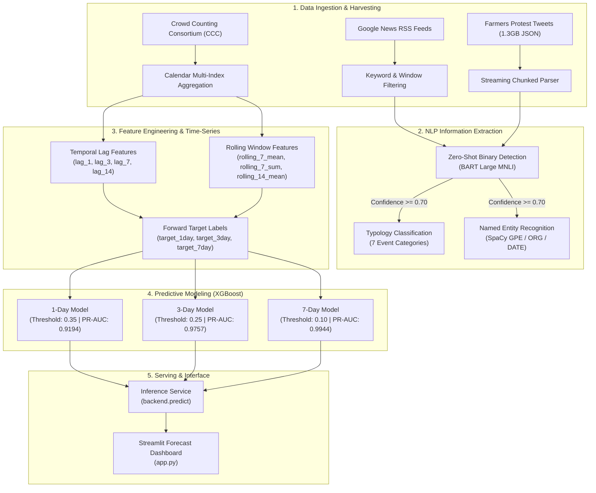

# Civil Unrest Event Extraction & Prediction from Social Media Data

A dual-tier machine learning system for extracting civil unrest events from unstructured text and forecasting multi-horizon protest activity using state-level temporal dynamics.

---

## 1. System Overview

This project comprises two distinct, complementary machine learning subsystems designed to study civil unrest:

1. **Unstructured NLP Extraction Pipeline**: Extracts unrest mentions, classifies 7 event categories (*protest, demonstration, strike, riot, labor dispute, political unrest, other*), and extracts named entities (locations, organizations, dates) from streaming tweets, social posts, and news RSS feeds using zero-shot classification (BART Large MNLI) and SpaCy NER.
2. **Structured Time-Series Forecasting Pipeline**: Aggregates event observations into daily state-level counts across all 50 US states and DC from the Crowd Counting Consortium (CCC) dataset (2021–2024), constructs historical lag and rolling statistical features, and forecasts positive unrest incidence across **1-day**, **3-day**, and **7-day** future horizons using calibrated XGBoost classifiers.
3. **Interactive Dashboard**: A modern Streamlit application providing region-based historical exploration, feature visualization, multi-horizon probabilistic risk gauges, and ground-truth validation.

> [!NOTE]
> **Subsystem Relationship**: The NLP event extraction and time-series forecasting pipelines are distinct, modular components. The NLP pipeline processes unstructured text (e.g., Google News RSS feeds, Farmers' protest tweets), while the predictive models are trained on structured historical event registries (Crowd Counting Consortium). They are evaluated independently and are not connected as a single end-to-end streaming feedback loop.



---

## 2. Benchmark Performance

The models were evaluated on the held-out **2024 calendar year** (19,386 state-day observations across all 50 states + DC), strictly separated from training (2021–2022) and validation (2023):

| Horizon | Calibrated Threshold | PR-AUC | F1-Score | Precision | Recall | Accuracy |
| :--- | :--- | :--- | :--- | :--- | :--- | :--- |
| **1-Day Horizon** | 0.35 | **0.9194** | 0.8398 | 0.8144 | 0.8670 | 80.60% |
| **3-Day Horizon** | 0.25 | **0.9757** | 0.9161 | 0.8838 | 0.9509 | 86.45% |
| **7-Day Horizon** | 0.10 | **0.9944** | 0.9681 | 0.9502 | 0.9868 | 94.15% |

### Baseline Comparison
Compared to the JHU-CUT Twitter benchmark (*Alexandra DeLucia et al., EMNLP 2020 W-NUT*) which evaluated tweet-level classification (BERTweet F1: 0.814, Keyword Count F1: 0.782), this architecture extends beyond single-text classification into multi-horizon geographic activity forecasting with high recall (86.7% to 98.7%).

---

## 3. Project Structure

```
civil-unrest-forecasting/
├── app.py                      # Interactive Streamlit forecast dashboard
├── requirements.txt            # Locked project dependencies
├── Makefile                    # Developer task automation
├── pytest.ini                  # Pytest configuration and testpaths
├── pyproject.toml              # Project packaging configuration
│
├── backend/                    # Core Python application package
│   ├── __init__.py
│   ├── data_processing.py      # CCC calendar multi-indexing & feature engineering
│   ├── predict.py              # Single & batch XGBoost inference engine
│   ├── train.py                # Standalone reproducible XGBoost training pipeline
│   ├── evaluation.py           # Metric calculation (PR-AUC, F1, Balanced Accuracy)
│   ├── evaluate_dataset.py     # 2024 test evaluation runner
│   ├── social_media_extraction.py # Zero-shot classification & SpaCy NER
│   ├── collect_protests.py     # Google News RSS harvester
│   ├── clean_protest_data.py   # Keyword & relevance filtering
│   ├── filter_event_periods.py # Temporal window filtering
│   ├── analyze_protest_timeline.py # Protest temporal analysis
│   ├── process_farmers_tweets.py  # Streaming 10k-chunk JSON tweet parser
│   └── clean_farmers_tweets.py    # Tweet normalization & deduplication
│
├── models/                     # Persisted model binaries & metadata
│   ├── metadata.json           # Features, calibrated thresholds, and hyperparameters
│   ├── xgboost_1day.json       # 1-day forecast model
│   ├── xgboost_3day.json       # 3-day forecast model
│   └── xgboost_7day.json       # 7-day forecast model
│
├── data/                       # Curated sample data & data documentation
│   ├── README.md               # Dataset schemas and acquisition guide
│   ├── demo_social_posts.csv   # 10 sample posts for pipeline smoke tests
│   ├── protest_articles.csv    # Harvested protest news headlines
│   ├── cleaned_protest_articles.csv # Cleaned protest articles
│   └── final_protest_articles.csv   # Window-filtered protest articles
│
├── results/                    # Benchmark metrics & case study extractions
│   ├── README.md               # Result catalog and evaluation documentation
│   ├── final_results.csv       # 2024 test metrics across horizons
│   ├── demo_extracted_events.csv # Extraction outputs for demo posts
│   ├── final_protest_extractions.csv # Extraction outputs for protest articles
│   └── protest_timeline.csv    # Aggregated protest frequency timeline
│
├── benchmark/                  # Comparative baseline documentation
│   └── README.md               # JHU-CUT baseline comparison
│
├── notebooks/                  # Research & exploration notebooks
│   └── Untitled74-2.ipynb      # Original model exploration and training
│
└── tests/                      # Automated test suite (40 unit tests)
    ├── test_data_processing.py # Feature calculation, lag math, and leakage tests
    ├── test_predict.py         # Model loading, boundary, and batch inference tests
    ├── test_train.py           # Split logic and dry-run training tests
    ├── test_evaluation.py      # Classification metrics and zero-division tests
    ├── test_nlp.py             # Input sanitization and extraction logic tests
    └── test_dashboard.py       # Streamlit compilation and execution flow tests
```

---

## 4. Quickstart Guide

### Prerequisites
* Python 3.10+ (tested on Python 3.13 macOS)
* Apple Silicon GPU (MPS), NVIDIA CUDA, or CPU

### Installation
Clone the repository and install dependencies:

```bash
# Clone repository
git clone <repo-url>
cd civil-unrest-forecasting

# Install dependencies and download SpaCy language model
make install
# Or manually:
pip install -r requirements.txt
python -m spacy download en_core_web_sm
```

---

## 5. Running the Test Suite

The project includes an extensive test suite (40 unit tests) covering temporal feature calculations, no-lookahead leakage guarantees, model inference, training dry-runs, and NLP pipeline sanitization:

```bash
# Run complete test suite
make test
# Or directly via pytest:
pytest
```

---

## 6. Launching the Forecast Dashboard

Run the Streamlit application to explore historical event patterns and generate real-time forecasts:

```bash
make dashboard
# Or directly via Streamlit:
streamlit run app.py
```

* **Region Selector**: Choose from all 50 US States + DC.
* **Observation Date**: Select any calendar date from 2021 to 2024.
* **Feature Display**: Inspect automatically computed 1, 3, 7, and 14-day lags alongside rolling statistics.
* **Generate Forecast**: Computes risk probabilities for 1-day, 3-day, and 7-day windows and evaluates against ground truth.

---

## 7. Model Training & Evaluation Replication

### Reproduce 2024 Test Set Evaluation
```bash
make evaluate
# Or:
python backend/evaluate_dataset.py
```

### Run Model Training Pipeline (Dry Run)
The training pipeline supports chronological data splitting, class imbalance weighting (`scale_pos_weight`), and threshold calibration:

```bash
# Verify split shapes and prevalence without overwriting production models:
python backend/train.py --dry-run

# Train and output to a separate directory:
python backend/train.py --output-dir temp_models/my_run
```

---

## 8. Limitations & Methodological Constraints

1. **Subsystem Decoupling**: The NLP event extraction pipeline (processing Twitter and Google News RSS feeds) and the state-level time-series forecasting models (trained on Crowd Counting Consortium event registries) operate as independent research modules. Event extractions are evaluated on domain-specific case studies and are not dynamically integrated into the XGBoost time-series feature matrix in real time.
2. **Geographic & Source Granularity**: The multi-horizon predictive models operate exclusively on US state-level aggregates from the Crowd Counting Consortium (2021–2024). International protest case studies (e.g., Nepal, Bangladesh, India) are evaluated through the NLP extraction subsystem.
3. **Data Exclusions**: Large raw datasets (such as the 1.3 GB tweet archive and 113 MB CCC CSV) are omitted from version control in accordance with data distribution policies and repository size best practices. Replicators must obtain raw files separately as documented in [`data/README.md`](data/README.md).
4. **Probabilistic Risk vs. Causality**: Forecasts represent empirical probability estimates derived from historical temporal momentum (lags and rolling statistics). They do not model root sociopolitical drivers, policy dynamics, or sudden exogenous shocks.
5. **Operational Disclaimer**: This repository is an academic research prototype intended for benchmarking and methodology exploration. It is not designed, calibrated, or validated for operational law enforcement, military, or tactical security decision-making.
